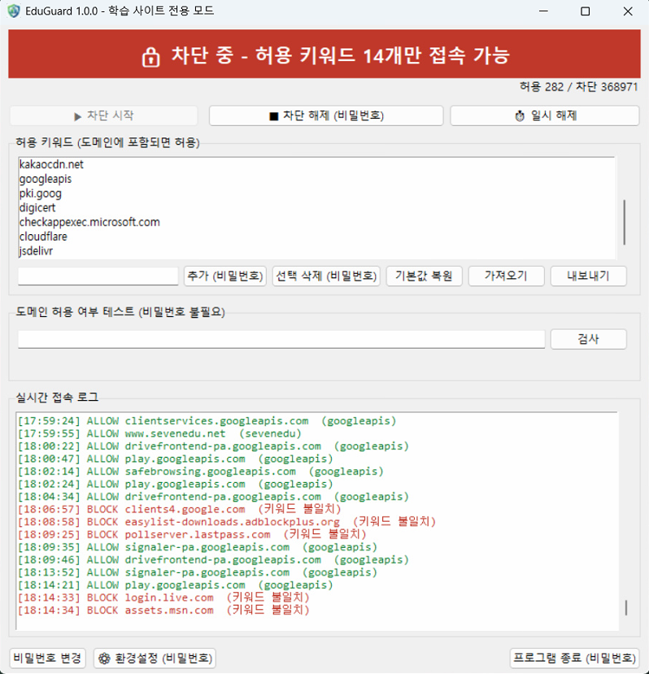
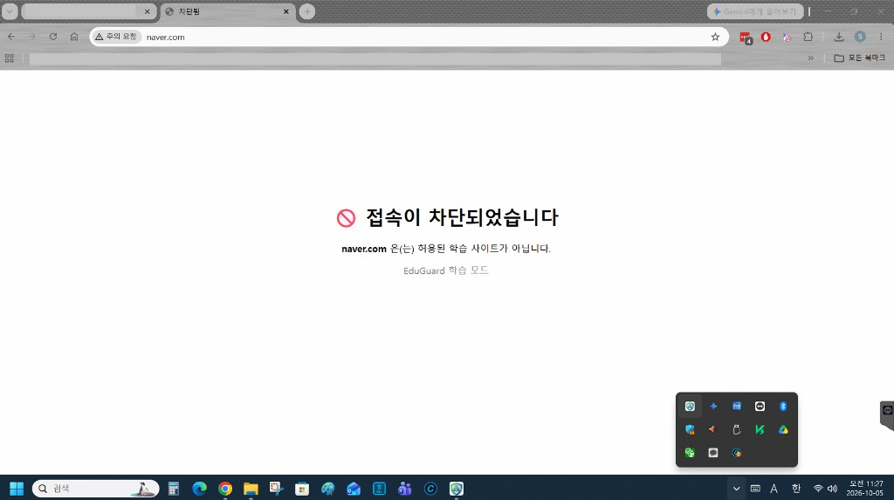

# EduGuard – 학습 사이트 전용 인터넷 제어 (Windows)

현재 버전: **1.0.0**

개발자 사이트: [note4all.tistory.com](https://note4all.tistory.com)

라이선스: [GNU GPL-3.0](LICENSE)

모든 인터넷 접속을 기본 차단하고, 호스트명에 **허용 키워드**(`ebs`, `sevenedu`, `starplayer`, `jwplatform`, `kollus`, `cloudfront` …)가 포함된 도메인만 통과시킵니다.

## 프로그램 실행 화면 예시
차단 중인 EduGuard 메인 화면입니다. 허용 키워드, 도메인 테스트, 실시간 접속 로그를 확인할 수 있습니다.



## 차단 화면 예시
허용되지 않은 사이트에 접속하면 아래처럼 EduGuard 차단 페이지가 표시됩니다.



## 구조
EduGuard 는 두 프로세스로 동작합니다.

- **엔진** (`EduGuardCore.exe` / `python main.py`): 관리자 권한의 Python 백그라운드 프로세스. 필터링 프록시, 시스템 프록시 설정·감시, 자동 차단, 워치독, 비밀번호 검증을 맡습니다. 화면이 없습니다.
- **UI** (`EduGuard.exe`): Electron + Tailwind CSS 화면과 트레이 아이콘. 엔진의 로컬 API(`127.0.0.1`, 임의 포트)를 호출만 합니다.

엔진은 시작할 때 포트와 1회용 토큰을 `runtime.json`(SYSTEM/관리자만 읽기 가능)에 기록하고, UI 는 이 파일로 엔진을 찾습니다. API 는 토큰 헤더와 `Host` 검사를 통과한 요청만 처리하며, 차단 해제·설정 변경 같은 보호 동작은 요청마다 엔진이 비밀번호를 직접 검증합니다. UI 창을 닫거나 UI 가 죽어도 엔진과 차단은 그대로 유지됩니다.

## 실행 (개발)
처음 한 번 UI 의존성을 설치합니다. (Node.js 20+ 필요)
```powershell
cd ui
npm install
node node_modules\electron\install.js   # npm 이 Electron 바이너리를 받지 않은 경우에만
npm run build:css
cd ..
```

```powershell
npm run dev               # CSS 빌드·감시 후 엔진+UI 실행 (UAC). 저장소 루트 또는 ui 폴더
npm run dev:stop          # 이 프로젝트의 엔진·Electron·CSS 감시만 종료
npm run dev:restart       # dev:stop 후 다시 dev
python main.py            # UAC 승인 후 엔진 실행 → UI 자동 실행, 최초 1회 비밀번호 설정
python main.py --backend  # 엔진만 실행 (UI 없이)
python main.py --no-admin # 개발용: UAC 생략 (현재 로그인 사용자에게만 적용)
python main.py --restore  # 비상용: 비밀번호 확인 후 시스템 프록시 원복
cd ui; npm start          # UI 만 실행 (엔진이 없으면 python main.py --backend 를 띄움)
python -m unittest -v test_eduguard   # 자동 테스트 (네트워크/레지스트리 미사용)
```
엔진은 외부 라이브러리 없이 Python 3.10+ 표준 라이브러리만 사용합니다. UI 스타일을 고칠 때는 `ui` 폴더에서 `npm run watch:css` 를 켜 두면 `src/input.css` 와 `renderer/*.html|js` 변경이 바로 반영됩니다.

## MSI 빌드
PyInstaller, Node.js, WiX Toolset v7이 설치된 Windows에서 실행합니다. 스크립트가 엔진(PyInstaller) → Tailwind CSS → Electron 패키징(`ui/scripts/package.mjs`) → WiX 순서로 빌드하며, `ui/node_modules` 가 없으면 `npm install` 도 자동으로 실행합니다.

```powershell
python scripts\build_msi.py
```

산출물은 `msi` 폴더에 아래 형식으로 생성됩니다.

```text
EduGuard_1.0.0_YYMMDD_HHMMSS.msi
```

예: `msi\EduGuard_1.0.0.2_261119_084853.msi`

`npm run build:update_all` 은 위 빌드와 같습니다.

## 배포 ("배포해줘")
Tiny PDF Editor - neo 와 같은 순서입니다. 자세한 규칙은 `.cursor/rules/deploy.mdc` 에 있습니다.

| 표시 | 예 |
| --- | --- |
| 앱·MSI (`version.py` `APP_VERSION`) | `1.0.0.2` |
| Git 태그·릴리스 태그 | `v1.0.0-2` |
| `package.json` version | `1.0.0-2` |

```powershell
npm run version:bump                 # 1.0.0.2 → 1.0.0.3 (1.0.0.9 다음은 1.0.1.0)
npm run build:update_all             # MSI
python -m unittest discover -s . -p "test_*.py"
npm run publish:release -- --notes-file=릴리스노트.md
```

`publish:release` 는 `main` 이 깨끗할 때만 태그 `v1.0.0-N` 을 만들고 GitHub Release 에 MSI 를 올린 뒤, 업로드가 확인되면 이전 릴리스와 이전 버전 태그를 지웁니다. 지운 태그의 커밋은 `.cache/logs/publish-release.log` 에 남습니다.

빌드 시각은 실행 파일에 포함되며, 메인 화면 오른쪽 **도구 → 버전 정보**에서 버전과 함께 확인할 수 있습니다. 소스 실행(`python main.py`)이면 빌드 시각 대신 `소스 실행`으로 표시됩니다.
**도구 → 프록시 상태**에서는 앱 차단 여부와 PC 레지스트리의 시스템 프록시(주소/PAC/잔여 설정 여부)를 바로 확인할 수 있습니다.

## 제거 / 업데이트
- 새 MSI를 기존 설치 위에 실행하면 같은 버전(`1.0.0`)이어도 업데이트 설치됩니다.
- MSI 제거 시 `--uninstall-cleanup` 정리 작업이 실행되어 시스템 프록시를 원복하고, 자동 실행 작업과 `config.json`, `proxy_backup.json`, `logs` 같은 실행 중 생성 파일을 삭제합니다.
- 제거 전 EduGuard 창에서 차단을 해제하고 프로그램을 종료하는 것을 권장합니다. 강제 종료된 상태에서도 정리 작업은 가능한 범위에서 수행됩니다.

## 업데이트 확인
프로그램 시작 후 백그라운드에서 업데이트 매니페스트를 확인합니다. 기본 URL은 비워 두었고, 배포 서버가 정해지면 `version.py`의 `UPDATE_MANIFEST_URL`을 설정하거나 실행 환경변수 `EDUGUARD_UPDATE_URL`로 지정할 수 있습니다.

매니페스트 예시:

```json
{
  "version": "1.0.1",
  "url": "https://example.com/EduGuard_1.0.1.msi",
  "notes": "버그 수정 및 안정성 개선"
}
```

현재 버전보다 높은 `version`이 있으면 알림과 다운로드 안내가 표시됩니다.

## 구성
| 파일 | 역할 |
|---|---|
| `main.py` | 진입점 – UAC 상승, 단일 실행, `runtime.json` 기록, 엔진/API 시작, UI 실행, CLI 옵션 처리 |
| `engine.py` | 엔진 – 차단 상태·자동 차단·일시 해제·키워드·설정·비밀번호 잠금·로그/알림 이벤트 |
| `api_server.py` | UI 용 로컬 HTTP API (토큰 + Host 검사, 127.0.0.1 전용) |
| `session_guard.py` | Windows 로그오프/종료 신호를 받아 시스템 프록시를 즉시 원복 |
| `ui/` | Electron UI – `main.js`(엔진 연결·트레이·창), `preload.js`(안전한 브리지), `renderer/`(화면), `src/input.css`(Tailwind) |
| `version.py` | 앱 이름/버전(`1.0.0`)/업데이트 매니페스트 URL. MSI 빌드 시 `build_info.py`에 빌드 시각이 포함됨 |
| `update_checker.py` | 시작 시 업데이트 매니페스트 확인 |
| `proxy_server.py` | 로컬 필터링 프록시 (HTTP + HTTPS CONNECT, 인증서 불필요) |
| `system_proxy.py` | 레지스트리 시스템 프록시 설정/원복, 변경 감시(2초) |
| `config_store.py` | `config.json` 저장 (PBKDF2 비밀번호 해시 + HMAC 무결성 + 파일 ACL) |
| `startup.py` | Windows 시작 시 자동 실행 – 작업 스케줄러(로그온, 최고 권한) 등록/해제 |
| `watchdog.py` | 강제 종료 감시 – 비정상 종료 시 EduGuard 재실행 |
| `starplayer_ready.py` | StarPlayer/Axissoft 프로세스 기동 여부 확인 |
| `scripts/build_msi.py` | PyInstaller(엔진) + Electron 패키징(UI) + WiX 기반 MSI 빌드 스크립트 |
| `assets/eduguard.ico`, `eduguard.png` | 앱 아이콘 (`icon_guide.jpg` 가이드에서 생성). 창/트레이/실행 파일에 적용 |
| `test_eduguard.py` | 단위/통합 테스트 (엔진·API 는 가짜 프록시로 검증) |

## 환경설정 (도구 → `⚙ 환경설정`, 부모님 비밀번호 필요)
설정 창은 `시작`, `차단`, `네트워크`, `로그`, `보안` 탭으로 나뉩니다.

| 탭 | 항목 | 기본값 | 설명 |
|---|---|---|---|
| 시작 | Windows 시작 시 자동 실행 | 꺼짐 | 작업 스케줄러에 "최고 권한/로그온 시"로 등록 (약 15초 지연). 관리자 권한으로 실행 중일 때만 변경 가능 |
| 시작 | 시작할 때 트레이 아이콘으로 실행 | 꺼짐 | 창을 띄우지 않고 트레이에서만 동작 |
| 시작 | 창 닫기(X) 시 트레이로 숨기기 | 켜짐 | 끄면 X = 프로그램 종료(비밀번호 확인) |
| 시작 | 트레이 알림 표시 | 켜짐 | 차단 시작/해제, 일시 해제, 트레이 숨김 안내 알림 |
| 시작 | 강제 종료 감시(워치독) | 꺼짐 | 작업 관리자 등으로 강제 종료되면 EduGuard를 다시 실행. 정상 종료는 재실행하지 않음 |
| 차단 | 프로그램 시작 시 자동 차단 시작 | 켜짐 | 스케줄이 꺼져 있을 때 자동 차단 |
| 차단 | 자동 차단 시작 지연 | 90초 | StarPlayer가 먼저 기동할 시간을 줌. 0 ~ 600초 |
| 차단 | StarPlayer 준비 확인 | 켜짐 | 프로세스 감지 전까지 차단을 미룸. 시간 초과 시 강제 시작 |
| 차단 | StarPlayer 추가 대기 | 120초 | 지연 이후에도 미기동이면 이 시간까지 더 대기 |
| 차단 | 시간대 스케줄 | 꺼짐 | 지정 시간대 안에서는 자동 차단, 밖에서는 자동 해제 |
| 차단 | 원격지원모드 허용 | 꺼짐 | TeamViewer 연결 유지를 위해 `teamviewer`, `dyngate` 도메인을 추가 허용 |
| 차단 | 일시 해제 기본 시간 | 30분 | `⏱ 일시 해제` 버튼의 기본 시간 |
| 차단 | 차단 페이지 문구 | 허용된 학습 사이트가 아닙니다. | HTTP 차단 페이지에 표시되는 문구 |
| 네트워크 | 필터 프록시 포트 | 8899 | 다음 차단 시작부터 적용 |
| 네트워크 | 프록시 설정 감시 주기 | 2초 | 시스템 프록시를 임의로 끄면 복구하는 주기 |
| 로그 | 반복 로그 숨기기 | 켜짐 | 같은 허용/차단 로그가 짧은 시간 안에 반복되면 다시 표시하지 않음 |
| 로그 | 반복 로그 숨김 시간 | 30초 | 중복 로그 판단 시간. 5 ~ 600초 |
| 로그 | 접속 로그 파일 저장 | 꺼짐 | `logs/eduguard-YYYYMMDD.log` 파일로 저장 |
| 로그 | 로그 보관 기간 | 30일 | 오래된 접속 로그 자동 삭제 |
| 로그 | 설정 변경 이력 기록 | 켜짐 | `logs/settings-history.log` 에 설정/키워드/차단 변경 기록 |
| 보안 | 비밀번호 실패 허용 횟수 | 5회 | 초과 시 잠금 |
| 보안 | 비밀번호 잠금 시간 | 30초 | 실패 횟수 초과 후 잠금 시간 |

> 자동 실행 작업은 **등록 시 사용된 관리자 계정**의 로그온에 묶입니다. 자녀(표준) 계정 로그온 때도 실행되는지는 PC 환경에서 꼭 확인하세요.
> 원격지원모드는 테스트/원격 유지 목적의 우회 허용입니다. 현재는 TeamViewer용 `teamviewer`, `dyngate` 계열 도메인만 추가로 열리므로 설치·점검이 끝나면 끄는 것을 권장합니다.
> StarPlayer/Axissoft 연동을 위해 `localhost.axissoft.co.kr`은 신뢰 로컬 호스트로 예외 허용합니다. 다른 루프백/사설 IP 접속은 계속 차단됩니다.
> EduGuard가 StarPlayer보다 먼저 뜨면 재생이 실패할 수 있어, 기본값으로 자동 차단을 90초 지연하고 StarPlayer 프로세스를 확인한 뒤 차단을 시작합니다.
> 프로그램 시작 시(차단 시작 전이라도) 이전 실행에 남은 `127.0.0.1:포트` 시스템 프록시/`proxy_backup.json`이 있으면 먼저 원래 설정으로 복원합니다. 재부팅 후에도 UI는 해제 상태인데 인터넷만 막히는 현상을 줄입니다.
> PC 종료·재시작·로그오프 직전에는 시스템 프록시를 원복해 다음 부팅에 잔여 프록시가 남지 않게 합니다. 강제 종료로 남은 경우에도 로그온 즉시 `EduGuardProxyCleanup` 작업(`--clear-stale-proxy`)이 먼저 복원을 시도합니다.

## 수동 테스트 순서
1. `python main.py` → 비밀번호 설정 → 자동으로 차단 시작
2. 브라우저에서 `https://www.google.com` → 차단 페이지/연결 오류, `https://www.ebs.co.kr` → 접속됨
3. 설정 > 네트워크 > 프록시에서 `127.0.0.1:8899` 확인. 직접 끄면 2초 안에 다시 켜짐
4. 차단 해제/키워드 추가·삭제/종료 시 비밀번호 창이 뜨는지 확인
5. 환경설정에서 트레이 시작/스케줄/로그/워치독 옵션을 켠 뒤 재시작·로그온·강제 종료 동작 확인

## 권장 운영 방법 (중요)
- **자녀 계정은 반드시 '표준 사용자'** 로 두세요. 관리자 계정이면 프로그램 종료·설정 변경·레지스트리 수정이 모두 가능해 우회됩니다.
- 프로그램은 `C:\EduGuard` 처럼 자녀가 쓰기 불가능한 폴더에 설치하세요. (사용자 폴더에 두면 파일 삭제 가능)
- 프로그램이 강제 종료돼도 프록시 설정은 죽은 포트를 가리키므로 **인터넷은 계속 차단**됩니다. 복구는 `--restore`.
- 부팅 시 자동 실행은 환경설정에서 켜세요. 직접 작업 스케줄러를 만드는 것보다 현재 설치 경로와 exe/script 실행 방식을 자동으로 반영합니다.

## 한계 (키워드 방식의 본질적 특성)
- 키워드는 **부분 문자열 매칭**이라 `ebs` 는 `webserver.com`, `forebs.net` 같은 도메인도 허용합니다. 가능하면 `ebsi.co.kr` 처럼 구체적으로 등록하세요. (현재 기본값은 요청 사양 그대로)
- `cloudfront` 는 무관한 사이트들의 CDN 도메인(`*.cloudfront.net`)도 모두 허용합니다.
- 프록시를 쓰지 않는 앱/VPN/Tor/브라우저 내 별도 프록시 설정은 막지 못합니다. 완전 차단이 필요하면 Windows 방화벽의 아웃바운드 규칙을 병행하세요.
- HTTPS 는 도메인만 확인하며 URL 경로·내용은 검사하지 않습니다.

## 라이선스
이 프로젝트는 [GNU General Public License v3.0](LICENSE)에 따라 배포됩니다.
